<!--
  DIYAZ SEISENBAYEV / JAPANESE-INSPIRED ENGINEERING SHOWREEL
  All original milestones, project links, claims and attribution are preserved.
  Local SVG + GIF assets; no JavaScript, external animation hosts, or visitor tracking.
-->

  

  
  
  

# Diyaz Seisenbayev 👋

**AI developer building practical tools for debugging, automation, and business systems.**

  
  
  

<table>
  <tr>
    <td align="center" width="33%">
      <strong>探究 — INQUIRY</strong> 
      Investigate hidden behavior.
    </td>
    <td align="center" width="34%">
      <strong>守護 — PROTECTION</strong> 
      Test assumptions and safeguards.
    </td>
    <td align="center" width="33%">
      <strong>創造 — CREATION</strong> 
      Build practical systems.
    </td>
  </tr>
</table>

---

## OpenAI open-source milestone

  
  

[**PR #2163**](https://github.com/openai/codex-security/pull/2163) was **merged into <code>openai/codex-security:main</code>** on November 4, 2026 (UTC).

> “Cool! Thank you for the contribution!”  
> — [@mldangelo-oai, PR reviewer](https://github.com/openai/codex-security/pull/2163#issuecomment-6640638679)

<strong>⚔️ Contribution focus — what changed</strong>

An open-source fix addressing **shell-escaped whitespace handling in repository paths**. The linked pull request is the source of truth for the change, discussion, and merge status.

---

## Featured projects

<table>
  <tr>
    <td width="50%" valign="top">
      <h3>🗡️ <a href="https://github.com/RakamakadoN/ghost-busters-skill">Ghost Busters Skill</a></h3>
      Read-only debugging protocol and static analyzers for silent failures. Selected work is included in the XERJ Corpus Hub.
      

    </td>
    <td width="50%" valign="top">
      <h3>🛡️ <a href="https://github.com/RakamakadoN/ghost-busters-pro">Ghost Busters PRO</a></h3>
      Security and code-analysis tooling.
      
Repository access may be restricted.

      

    </td>
  </tr>
  <tr>
    <td colspan="2" valign="top">
      <h3>⚡ <a href="https://github.com/openai/codex-security/pull/2163">OpenAI codex-security contribution</a></h3>
      Fixed shell-escaped whitespace handling in repository paths; <strong>PR #2163 merged into <code>main</code></strong>.
      

    </td>
  </tr>
</table>

  

## Areas of interest

**AI agents · Developer tooling · CRM/ERP · Static analysis · Geospatial systems**

  
  
  
  
  

### Engineering loop

<table>
  <tr>
    <th align="center">01 · Observe</th>
    <th align="center">02 · Reproduce</th>
    <th align="center">03 · Verify</th>
    <th align="center">04 · Improve</th>
  </tr>
  <tr>
    <td align="center">Form a testable hypothesis</td>
    <td align="center">Bound the scenario</td>
    <td align="center">Collect inspectable evidence</td>
    <td align="center">Patch and protect with tests</td>
  </tr>
</table>

<blockquote>
  
<strong>Build things that work. Investigate things that fail silently. Let evidence distinguish a hypothesis from a finding.</strong>

</blockquote>

---

  侍の美学 — Japanese-inspired visual design · Code, evidence &amp; craft

> Badges link to verifiable contributions: the XERJ badge recognizes selected **Ghost Busters Skill** work, and the OpenAI badge links to a merged open-source PR. Neither badge implies employment, organization membership, endorsement, or certification.
