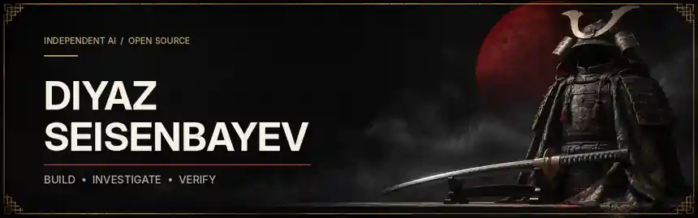

<!--
  DIYAZ SEISENBAYEV · GITHUB PROFILE
  Japanese-inspired visual identity; all claims link to primary evidence.
  Existing artwork and animation are retained in /assets.
-->

  

  探究 · 守護 · 創造 &nbsp; | &nbsp; INQUIRY · PROTECTION · CREATION

# Diyaz Seisenbayev

**Independent AI developer · Open-source contributor · Debugging & developer tooling**

I build practical tools for **AI-assisted investigation, automation, and business systems**. I focus especially on *silent failures*: cases where a process reports success, but the actual outcome is incomplete, incorrect, or attributed to the wrong source.

My approach: **understand the system → follow the evidence → reproduce the behavior → improve the implementation**.

  
  

---

## Selected open-source contributions

### 🧶 XERJ Corpus Hub · Selected source-code reference

**[Ghost Busters Skill](https://github.com/RakamakadoN/ghost-busters-skill) was selected for the [XERJ Corpus Hub](https://hub.xerj.org/contributors/RakamakadoN) on October 24, 2026.**

XERJ includes the project's source code in its **reference corpus for AI coding agents**. An agent can find implementation examples from the indexed files and retrieve answers with references to the originating repository, commit, file, and line.

| XERJ record | Verified selection |
| :-- | :-- |
| **Indexed source** | Full repository snapshot: **23 files · 135.8 KB** |
| **Pinned revision** | [`b583898c8c`](https://github.com/RakamakadoN/ghost-busters-skill/commit/b583898c8c3e4e1f07fa2cdf257093350baf3e71) |
| **Highlighted work** | **1 selected commit · 3 files · 179 lines** in the contributor registry |
| **Authorship** | **Diyaz Seisenbayev · @RakamakadoN** |
| **License** | **MIT, with attribution** |

The indexed work covers the Ghost Busters debugging toolkit: an approach to identifying failures that conventional success indicators can overlook, including static analysis, reference tests, and practical investigation patterns.

**Explore the evidence:** [XERJ contributor profile](https://hub.xerj.org/contributors/RakamakadoN) · [Indexed Ghost Busters corpus](https://hub.xerj.org/corpus/rakamakadon--ghost-busters-skill) · [Selected source commit](https://github.com/RakamakadoN/ghost-busters-skill/commit/b583898c8c3e4e1f07fa2cdf257093350baf3e71)

### ⚡ OpenAI codex-security · Merged contribution

**[PR #2163 — fix(activity): preserve shell-escaped whitespace in repository paths](https://github.com/openai/codex-security/pull/2163)** was merged into **`openai/codex-security:main`** on **November 4, 2026 (UTC)**.

**The problem:** A POSIX shell-escaped space or tab in a path could cause scan activity to report an incorrect filename. For example, a command reading `src/my\ file.ts` could be attributed to `src/my`.

**The change:** Preserve escaped whitespace when interpreting supported shell events, respect literal argv operands, and distinguish real file references from unrelated quoted text.

**The verification:** Reproduction of the original behavior, activity-adapter test cases, SDK activity tests, type checks, formatting, and portable-plugin checks are documented in the [pull request](https://github.com/openai/codex-security/pull/2163).

> “Cool! Thank you for the contribution!”  
> — [@mldangelo-oai, PR reviewer](https://github.com/openai/codex-security/pull/2163#issuecomment-6640638679)

---

## Projects

### 🛡️ Ghost Busters Skill

**[Explore Ghost Busters Skill](https://github.com/RakamakadoN/ghost-busters-skill)** — an open-source, read-only debugging protocol and toolkit for investigating *silent failures*.

A ghost is a defect that may look like a successful operation: missing data behind a green status, an incorrect attribution, a stale observation, or a business invariant that quietly stops holding.

- **8-phase investigation protocol** and a catalogue of **13 classes of silent bugs**.
- **Static analyzers, evidence gates, regression fixtures, and read-only investigation tools**.
- Investigation patterns grounded in real CRM/ERP debugging experience, with examples and explicit evidence checks.
- Selected work is included in the **XERJ Corpus Hub** (details above).

[Repository](https://github.com/RakamakadoN/ghost-busters-skill) · [Bug taxonomy](https://github.com/RakamakadoN/ghost-busters-skill/blob/main/references/ghost-classes.md) · [Tests](https://github.com/RakamakadoN/ghost-busters-skill/tree/main/tests)

### ⚔️ Ghost Busters PRO

**[Ghost Busters PRO](https://github.com/RakamakadoN/ghost-busters-pro)** — security and code-analysis tooling built around source tracing, investigation of hidden behavioral defects, and structured evidence.

The project's workflow includes bounded, read-only analysis and reproducible test scenarios.

### 🔍 OpenAI codex-security contribution

A concrete example of the debugging process applied to an external codebase: **identify an incorrect recorded outcome → reproduce it → change the handling → test the affected paths**.

[Read the merged change in OpenAI's repository](https://github.com/openai/codex-security/pull/2163).

---

## Engineering focus

**AI agents · Developer tooling · CRM/ERP · Static analysis · Geospatial systems**

| Stage | What I look for |
| :-- | :-- |
| **01 · Observe** | What actually happened, beyond the success message? |
| **02 · Reproduce** | Can the behavior be demonstrated with a bounded example? |
| **03 · Verify** | Which source, test, or invariant supports the result? |
| **04 · Improve** | What changes, and which regression checks preserve the fix? |

> Build things that work. Investigate things that fail silently. Let evidence distinguish a hypothesis from a finding.

---

  <i><strong>“Mastery of the sword, untested in battle, 
  is like learning to swim on dry land.”</strong></i>

  — Hanshirō Tsugumo · <i>Harakiri</i> (1962) · English rendering

  
<strong>🗡️ Katana glint · Animation</strong>

  

    
  

  侍の美学 · Code, evidence &amp; craft

